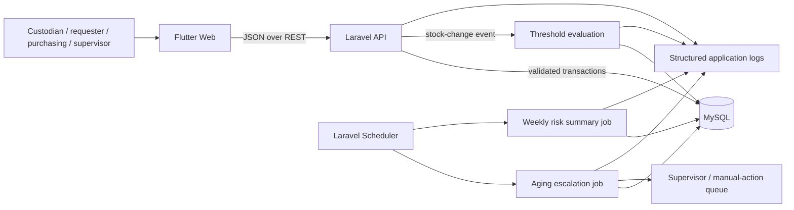

# Project 25 System Architecture

## Status and scope

This document records the approved design and current Week 13 implementation. The user-proposed stack is Flutter Web, a Laravel REST API, and MySQL. The guide requires a Flutter Web interface with an approved backend API; Laravel and MySQL are the chosen technologies, subject to any instructor approval required by the course. The database/API were validated against MariaDB 10.4 via Laravel's MySQL driver; the installed MySQL 8 service was unavailable for a separate final check.

### Workflow boundary

**Included workflow:** approved supply stock transaction → threshold evaluation → alert and reorder recommendation → human review → procurement status tracking → receipt → closure.

**Week 13 automation:** threshold alerts, active-reorder duplicate prevention, aging escalation, weekly stock-risk summaries, bounded retry/recovery, structured logs, and a human-action route for permanent failure.

**Not automated:** purchasing decisions, purchase-order placement, vendor communication, payments, or automatic approval. A human reviews recommendations and records procurement progress and receipt.

**Users:** custodians record and review stock; requesting personnel submit or view requests as permitted; purchasing staff record procurement progress and receipt; supervisors review escalations and manual actions. Exact permissions need approval.

**Approval authority:** supervisor, as confirmed by the student. The Week 13 prototype defines the authorization contract and UI state but defers authentication/role enforcement implementation to Week 14.



## Trigger decisions

| Trigger | Decision | Idempotency / duplicate protection |
|---|---|---|
| Stock transaction is committed | Recalculate on-hand quantity. If quantity is at or below the item threshold, open or retain a low-stock alert and create a recommendation only if no active recommendation exists for that item. | Update stock, record transaction, and decide alert/recommendation in one database transaction while locking the inventory item row. All paths that change stock or create a recommendation must use this rule. |
| Stock rises above threshold | Resolve the current low-stock alert episode. Do not silently close a procurement workflow; that still requires the defined workflow action. | Resolve the current episode once; a later drop below threshold starts a new alert episode. |
| Daily aging scan | Find non-terminal recommendations whose time in the current workflow state is at least seven calendar days. Escalate each eligible record once per escalation level to the supervisor/manual-action queue. | Use a unique escalation identity per recommendation and escalation level; update the workflow and record the escalation atomically. |
| Weekly schedule | Every Monday at 08:00 Asia/Manila, snapshot the completed Monday-to-Sunday reporting week: approved items at/below threshold and their active recommendation/procurement state. | Use a unique week key and upsert/reuse the same summary on retry rather than creating duplicate summaries. |

The guide does not prescribe these operational values. The student confirmed a seven-calendar-day aging limit, a daily scan, a Monday-to-Sunday reporting week, and summary generation every Monday at 08:00 Asia/Manila. The proposed threshold comparison is **on-hand quantity <= reorder threshold**.

## Proposed data model

Tables marked below are implemented by Laravel migrations or the Laravel starter migration. Use foreign keys, timestamps, and database transactions for related state changes. Quantity precision is `DECIMAL(14,3)`; approved units remain controlled seed/user data.

| Table | Planned data and relationships |
|---|---|
| `users` | Laravel starter `users` table with name/email/password fields. It is not connected to the workflow and is not an authentication implementation for the API. |
| `roles`, `user_roles` | Planned for secure integration. Role names include custodian, requester, purchasing, and supervisor; many-to-many user/role mapping and enforcement are deferred to Week 14. Supervisor approval authority is confirmed. |
| `inventory_items` | `id`, unique SKU, name, unit, on-hand quantity, reorder threshold, suggested reorder quantity, active/approved flag, timestamps. |
| `stock_transactions` | `id`, `item_id`, actor, transaction type (issue, receipt, adjustment), positive quantity, optional reason/reference, resulting quantity, timestamp. Every stock change is recorded; quantities are not silently overwritten. |
| `inventory_alerts` | `id`, `item_id`, low-stock episode number, status (open, acknowledged, resolved), triggered/acknowledged/resolved timestamps. Unique `(item_id, episode_number)`. |
| `reorder_requests` | `id`, `item_id`, source alert, suggested quantity, status (pending_review, approved, rejected, ordered, partially_received, received, closed, cancelled), reviewer, timestamps, last state-change time. Enforce at most one active request per item by locking the item row in the same transaction on every creation path. |
| `workflow_events` | `id`, subject type/id, actor, action, previous/current state, optional reason, correlation id, timestamp. Append a row for each auditable stock/workflow state change; do not overwrite history. |
| `escalation_events` | `id`, reorder request, escalation level, reason, created/resolved timestamps. Unique `(reorder_request_id, escalation_level)` prevents repeated escalation for the same level. |
| `weekly_stock_summaries` | `id`, unique week start/end key, generated timestamp, status, risk item count, automation run reference. |
| `weekly_stock_summary_items` | Snapshot rows linked to a summary and item, including quantity, threshold, and the relevant reorder status at generation time. |
| `automation_runs` | `id`, automation type, unique idempotency key, period/subject, attempt count, status, next retry time, sanitized last error, start/finish timestamps. |
| `manual_actions` | `id`, source automation/reorder, action reason, assigned role/queue, status (open, resolved), resolution note, created/resolved timestamps. |

**Relationships:** an item has many stock transactions, alert episodes, and reorder requests. An alert episode can be the source of a reorder request. A reorder request can have escalation events and manual actions. A weekly summary has snapshot item rows. Automation runs can point to a subject and/or manual action.

**Concurrency invariant:** every code path that creates an active reorder locks its item row before checking active requests and inserting. The implementation must test simultaneous trigger attempts; a sequential “check then insert” without a shared lock is insufficient.

**Active-request rule:** `pending_review`, `approved`, `ordered`, `partially_received`, and `received` remain active until explicitly closed. `rejected`, `closed`, and `cancelled` are terminal. In particular, a received request must not be treated as closed without the required closure action.

## API contract

The implemented base path is `/api/v1`. Endpoints accept and return JSON; path identifiers are integers. Successful responses use a `data` envelope. List responses are arrays in `data`, with no pagination metadata. The response fields described below are those returned by the current Laravel controller; database-row responses include the row's stored columns.

| Method and path | Implemented behavior and request data |
|---|---|
| `GET /health` | Returns `{"data":{"status":"ok"}}`. |
| `GET /items` | Lists all approved inventory items, ordered by name. Each row includes stored item columns and `below_threshold`. No pagination or metadata is returned. |
| `POST /items` | Creates an item and its initial stock transaction. Required: `sku` (string, max 40, unique), `name` (string, max 255), `unit` (string, max 30), `on_hand_quantity` (0 through 99,999,999,999.999), `reorder_threshold` (same range), `suggested_reorder_quantity` (>0 through 99,999,999,999.999). Quantity values must have at most three decimal places. Returns the created inventory row in `data` with status 201. |
| `GET /items/{itemId}` | Returns `data.item`, `data.below_threshold`, `data.current_alert` (row or null), and `data.active_reorder` (row or null). Unknown/unapproved items return 404. |
| `POST /items/{itemId}/transactions` | Required: `type` (`issue`, `receipt`, or `adjustment`), `quantity`; optional: `reason` (string, max 1000). Quantity must fit `DECIMAL(14,3)` and have at most three decimal places. Issue and receipt quantities must be positive; adjustments may be positive or negative but cannot be zero. A transaction that would make stock negative returns 422. Success returns transaction id, item id, resulting quantity, alert decision, and recommendation decision, status 201. |
| `GET /alerts` | Lists at most 200 alerts, newest first. Optional filters: `status` (`open`, `acknowledged`, `resolved`), `item_id` (positive integer). Returns `data` array, without pagination metadata. |
| `POST /alerts/{alertId}/acknowledgement` | Acknowledges an open alert; repeated acknowledgement returns its existing row. No request fields are required. A non-open alert returns 409; a missing alert returns 404. Success returns the alert row in `data`. |
| `GET /reorder-requests` | Lists at most 200 requests, newest first. Optional filters: `status` (`pending_review`, `approved`, `rejected`, `ordered`, `partially_received`, `received`, `closed`, `cancelled`), `item_id` (positive integer). Returns `data` array, without pagination metadata. |
| `POST /reorder-requests/{requestId}/review` | Required: `decision` (`approve` or `reject`); optional: `note` (string, max 1000). Only `pending_review` requests can be reviewed. Other states return 409. Success returns the updated request row. |
| `PATCH /reorder-requests/{requestId}/procurement-status` | Required: `status` (`ordered`). Only an `approved` request can be marked ordered; other transitions return 409. Success returns the updated request row. |
| `POST /reorder-requests/{requestId}/receipts` | Required: positive `quantity` with at most three decimal places and within the `DECIMAL(14,3)` range. Only `ordered` or `partially_received` requests can receive stock, and the quantity cannot exceed the remaining suggested quantity. Invalid quantity/remaining amount returns 422; invalid state returns 409. Success returns the updated request row. |
| `POST /reorder-requests/{requestId}/close` | Required: `resolution_note` (string, max 1000). Only a `received` request can be closed; other states return 409. Success returns the updated request row. |
| `GET /stock-risk/weekly` | Lists at most 52 summaries, newest period first. Optional filter: `week_start` in `YYYY-MM-DD` format. Each summary row includes its `items` snapshot array. No generation-status field or pagination metadata is returned. |
| `GET /manual-actions` | Lists at most 200 manual actions, newest first. Optional filter: `status` (`open` or `resolved`). Returns `data` array, without pagination metadata. |
| `POST /manual-actions/{actionId}/resolve` | Required: `resolution_note` (string, max 1000). A resolved action cannot be resolved again (409). Success returns the updated manual-action row. |

`GET /alerts` and `GET /reorder-requests` do not implement date or age filters. Alert acknowledgement does not accept a note. Procurement status currently supports only `ordered`; partial receipts are recorded through the receipt endpoint. The implementation does not accept reference fields on the documented mutations.

### Response and error conventions

Successful reads and updates return 200; creates return 201. List responses use `{"data":[...]}`; item/summary/resource responses use `{"data": ...}`. Responses do not include pagination metadata.

```json
{
  "data": {
    "transaction_id": 41,
    "item_id": 8,
    "on_hand_quantity": 4,
    "threshold_alert": "opened",
    "reorder_recommendation": "created"
  }
}
```

JSON validation failures use Laravel's standard 422 shape; field-specific validation errors appear under `errors`:

```json
{
  "message": "The quantity field must be greater than zero.",
  "errors": {
    "quantity": ["The quantity field must be greater than zero."]
  }
}
```

Implemented status behavior: `200` read/update success, `201` creation, `404` missing resource, `409` invalid workflow-state conflict, and `422` request or business validation failure. Unexpected exceptions use Laravel's JSON exception rendering for API paths and return 500; their detail shape depends on the environment's debug configuration and is not a custom stable response contract. The backend does not itself generate 503 responses; those can come from an unavailable upstream/server. Every API response includes an `X-Correlation-ID` header, using the valid incoming value or a generated UUID.

The Week 13 Flutter/API contract includes presentation of 401/403 responses, but the API currently has no authentication or role middleware and does not enforce authorization. Server-side 401/403 behavior is deferred to Week 14 and is not claimed as implemented. A network failure or upstream `503` is a client/API availability condition, not an authorization or validation response.

## Flutter Web screen flow

```text
Inventory dashboard
  ├─ Inventory list/detail → Record stock issue/receipt/adjustment
  │    └─ Confirm → loading → updated balance + alert/reorder outcome
  ├─ Alerts → alert detail → acknowledge
  ├─ Reorder queue → recommendation detail
  │    ├─ Review → approve/reject
  │    ├─ Procurement status → ordered / partial receipt
  │    ├─ Record receipt → close when resolved
  │    └─ Age indicator → supervisor escalation
  ├─ Weekly risk summaries → select week → summary/detail
  └─ Manual actions → inspect permanent failure → record human resolution
```

Each data screen needs loading, populated, empty, validation, unauthorized, network-unavailable, and server-error states as applicable. Mutations need pending/disabled-submit behavior, success confirmation, and a safe retry message that does not cause duplicate stock transactions. Responsive layout must work at narrow and wide browser sizes. The unauthorized state and role visibility are part of the planned contract; authentication hardening is not implemented in this Week 13 planning task.

## Retry, recovery, and escalation policy

Proposed initial policy (confirm before implementation):

1. Retry only transient technical failures such as a database deadlock/temporary connection interruption while running an idempotent scheduled job. Do not retry validation errors, invalid state transitions, or missing/invalid owner configuration.
2. Limit an automation run to **three total attempts**. Proposed delays: one minute, then five minutes; after the final failed attempt, stop. The values are configurable design choices, not guide-prescribed values.
3. Wrap each summary/escalation write in a database transaction. Use its unique period/subject idempotency key so a retry cannot create a duplicate summary, alert, or escalation.
4. Record attempt count and next retry time. If the primary database is unavailable, the job cannot safely persist a retry/manual-action row; emit a structured application log and let the scheduler/operations recovery process re-run the idempotent job when the database returns.
5. On non-retryable or exhausted failure, mark the run terminal when persistence is available and create a durable open manual-action item. A human corrects the missing owner/configuration or data issue, records disposition, and explicitly re-runs/resolves the affected work.
6. Never silently report a failed run as successful. The UI shows the last known successful summary and clearly indicates when the current scheduled summary failed or is stale.

**Required demonstration designs (not yet executed):**

- **Recovered transient failure:** inject a temporary database lock/connection failure during a weekly summary save; first attempt rolls back, a later bounded attempt succeeds, and the unique week key leaves exactly one complete summary. Capture all attempts and final state.
- **Permanent failure to human action:** configure a reorder escalation with no resolvable supervisor owner. Classify it as non-retryable, create one open manual-action item in the supervisor queue, stop automated attempts, and record a human owner assignment/resolution. Capture terminal logs and the manual disposition.

## Structured logging

Implemented in Phase 3B. Week 13 inventory automation events are written by `App\Logging\AutomationLog` to a dedicated Laravel channel named `automation` (configured in `backend/config/logging.php`). Unrelated Laravel logging (`laravel.log`, the `single`/`stack` channels, framework errors, `report()` output) is unchanged and keeps its default text format.

- **Location:** `backend/storage/logs/automation.log`. Override with `LOG_AUTOMATION_PATH`; the minimum level is `LOG_AUTOMATION_LEVEL` (default `debug`). There is no rotation, retention or shipping configured.
- **Format:** `App\Logging\StructuredLogFormatter` writes one flat JSON object per line (newlines inside values are JSON-escaped, so a record never spans lines). Timestamps are UTC ISO-8601 with milliseconds.
- **Always present:** `timestamp`, `level` (lowercase), `event`, `correlation_id`.
- **Present when applicable (null fields are omitted):** `automation_run_id`, `idempotency_key`, `inventory_item_id`, `reorder_request_id`, `manual_action_id`, `attempt`, `outcome`, `duration_ms`, `error_code`, `error`, plus event-specific fields such as `alert_decision`, `reorder_decision`, `quantity`, `threshold`, `escalated_count`, `week_start`, `week_end`, `risk_item_count`.

```json
{"timestamp":"2026-10-30T11:54:44.126Z","level":"warning","event":"sample.event","correlation_id":"314e2db8-4c36-4683-a406-3f84a8c26304","automation_run_id":1,"attempt":1,"outcome":"retry_scheduled","error_code":"X","error":"password=[REDACTED] ok","duration_ms":5}
```

This is a real line produced by the configured channel during Phase 3B verification, using a synthetic `sample.event` and test values (not a real workflow run); it shows the field layout and redaction.

**Events currently logged:** `inventory.threshold_evaluated`, `reorder.aging_escalated`, `automation.aging_permanent_failure_manual_action_created`, `reorder.aging_scan_completed`, `reorder.aging_scan_failed`, `weekly_stock_summary.generated`, `weekly_stock_summary.recovered`, `weekly_stock_summary.attempt_failed`, `weekly_stock_summary.manual_action_created`, `weekly_stock_summary.manual_action_persistence_failed`. Other workflow steps (alert acknowledgement, review, procurement, receipt, close, manual-action resolution) are recorded in the `workflow_events` table, not in this log. A weekly run that is skipped because it is already completed, or blocked by an open manual action, is not logged.

**Correlation ID:**
- For HTTP requests, the valid incoming `X-Correlation-ID` (or a generated UUID) is preserved and used in log lines and in `workflow_events.correlation_id`.
- Each automation execution (`processAging()` and `generateWeeklySummary()`) generates its own UUID, shared by every log line and `workflow_events` row from that execution. Two separate executions have different IDs.
- Outside both, a one-off UUID is generated per log call.

**Duration:** `duration_ms` is measured with a monotonic clock. It is recorded for threshold evaluation, each aging escalation, the whole aging scan, each weekly-summary attempt, and the final manual-action routing (total elapsed run time). It is not recorded for events that have no timed operation.

**Sanitization:** the formatter redacts values under keys containing password, secret, token, authorization, credential, api key, cookie or private key (or starting with `DB_`), and scrubs `password=…`/`token=…` pairs, `Bearer` tokens and `user:password@` URL credentials inside strings. Strings over 500 characters are truncated. In addition, the automation service logs only a fixed error summary (for database errors, only the SQLSTATE) and a stable `error_code` (`SIMULATED_TRANSIENT_FAILURE`, `DATABASE_QUERY_FAILURE`, `AUTOMATION_FAILURE`, `SUPERVISOR_OWNER_NOT_CONFIGURED`); raw exception messages, SQL and bindings are never written to this log. Redaction is pattern-based, so it is a safeguard, not a guarantee for unforeseen secret formats.

A failure to write the log is swallowed (reported through PHP `error_log`) so logging cannot roll back or fail the workflow.

**Basic troubleshooting:**
1. Find an event: `Select-String -Path backend\storage\logs\automation.log -Pattern '"level":"error"'` (or `"event":"weekly_stock_summary.attempt_failed"`).
2. Copy its `correlation_id` and search for it in the log to see every event of that execution or request; the same value is stored in `workflow_events.correlation_id`.
3. Use `automation_run_id` / `idempotency_key` to find the `automation_runs` row (`status`, `attempt_count`, sanitized `last_error`) and the open `manual_actions` row that needs human action.
4. If the file is missing, no automation event has been written yet or `LOG_AUTOMATION_PATH` points elsewhere. A line that does not parse as JSON should not occur; report it as a defect.
5. A parse of each line can be checked with `Get-Content backend\storage\logs\automation.log | ForEach-Object { $_ | ConvertFrom-Json } | Out-Null`.

Durable application state (`automation_runs`, `manual_actions`, `workflow_events`) is the source for workflow recovery; logs support diagnosis and evidence.

Not implemented: a `next_retry_at` column, log rotation or retention, and central log shipping.

## Maintainability note

Keep threshold/reorder decisions in `InventoryWorkflowService` and scheduled work in `StockRiskAutomationService`; keep database changes in transactions; use centralized status lists and documented transitions. Flutter screens call the API rather than reimplementing business decisions. The implementation has feature tests and local run instructions, but the complete Flutter/API click-through and Week 14 security work remain outstanding.

## Decisions and information still needed

- Confirm instructor approval of the project and proposed Laravel/MySQL backend, if applicable.
- Confirm initial inventory data, units/precision, who can create/approve items, and role permissions.
- The aging duration is seven calendar days; the scan is daily. Escalation levels/cadence after the first escalation and summary retention still need confirmation.
- The reporting period is Monday–Sunday, generated Mondays at 08:00 Asia/Manila. Summary retention and viewing permissions still need confirmation.
- Confirm whether the prototype uses only in-app alerts (planned) or any additional delivery channel; no external provider is assumed.
- Week 13 defines 401/403 contract and UI paths only; authentication/role enforcement implementation is deferred to Week 14, as confirmed by the student.
- Confirm local development/deployment expectations and the approved controlled-data source.
